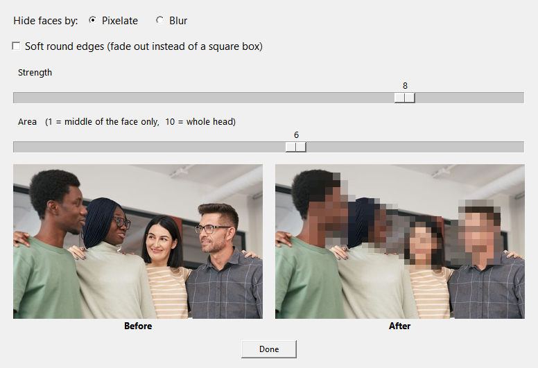

# blurface

Hide faces in your photos before you share them.

Drag photos into the app and it saves copies with every face pixelated or blurred. Your original photos are never changed, and everything runs offline on your computer.



## Setup

Needs Python 3 (tested with Python 3.13 on Windows 10).

```
pip install -r requirements.txt
python face_pixelator.py
```

Keep `face_detection_yunet_2023mar.onnx` and `sample.jpg` in the same folder as the script.

## How to use

1. Drag a folder, or one or more photos, onto the window.
2. The results are saved in a `pixelated` (or `blurred`) folder next to your photos.
3. Click the gear icon to change the settings. The preview updates as you change them.

## Settings

- **Pixelate or Blur**: how faces are hidden.
- **Strength**: how heavy the pixelation or blur is.
- **Area**: how much is covered, from the middle of the face to the whole head.
- **Soft round edges**: fades the effect into the photo instead of a square box.

## Good to know

- Finds small faces in group photos and large faces in close-ups.
- Supports JPG, PNG, WebP, BMP, TIFF and iPhone HEIC photos. HEIC photos are saved as JPG.
- Removes hidden photo data, such as GPS location and camera details, from the saved copies.
- Face detection is not perfect, so check the results before sharing. Photos where no face was found are listed in the app.

## Credits

- Face detection: [YuNet](https://github.com/opencv/opencv_zoo/tree/main/models/face_detection_yunet) model from OpenCV Zoo, MIT license (see `LICENSE-yunet.txt`).
- Sample photo: [Pexels](https://www.pexels.com/photo/5946219/).
